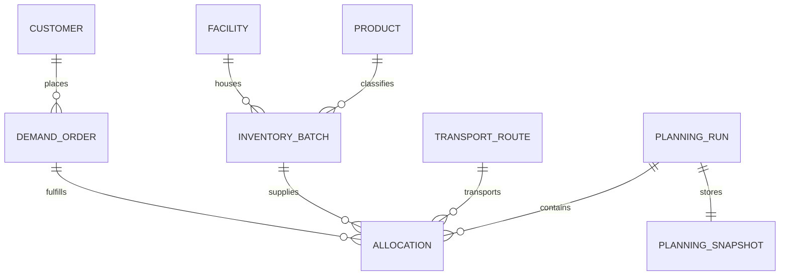

# FreshRoute: System Architecture & Technical Specifications

## 1. Architectural Principles & Isolation Boundaries
FreshRoute is engineered under strict decoupling invariants to ensure testability, auditability, operational reliability, and zero vendor lock-in.

```
┌────────────────────────────────────────────────────────────────────────┐
│                        Presentation Layer (UI)                         │
│   Next.js 15 App Router | Server Components (Default) | Client Leaves  │
│          SCSS Modules Design System | Radix UI Headless Primitives     │
└───────────────────────────────────┬────────────────────────────────────┘
                                    │ (Typed Server Actions / API Routes)
┌───────────────────────────────────▼────────────────────────────────────┐
│                       Application & API Handlers                       │
│    Zod Input Validation | Clerk Authentication & RBAC | Audit Logging   │
└───────────────────┬────────────────────────────────┬───────────────────┘
                    │                                │
┌───────────────────▼──────────────┐   ┌─────────────▼───────────────────┐
│       Data Access Layer          │   │      Domain Optimization        │
│   PostgreSQL + Prisma ORM        │   │        Solver Engine            │
│   Decimal-Safe Currency Types    │   │  - 100% Pure TypeScript         │
│   Transactional Snapshot Store   │   │  - Zero React/Prisma/Next.js    │
│   Synthetic Demo Seed Provider   │   │  - Deterministic Math & FEFO    │
└──────────────────────────────────┘   │  - Dynamic Markdown Elasticity  │
                                       │  - Documented Baseline Engine   │
                                       └─────────────────────────────────┘
```

### Boundary Invariants:
1. **Presentation Layer Architecture**:
   - **Server Components by Default**: Next.js 15 App Router pages and layouts render server-side by default with zero unnecessary client JS bundle.
   - **Client Boundaries**: Explicit `'use client'` leaves for interactive widgets (`NetworkFlowVisualizer`, `BaselineComparisonVisualizer`, `OperationsOverview`, `Dialog` Radix modal, and `AppHeader` ticking clock).
   - **Design Token System (`src/styles/_tokens.scss`)**: Comprehensive SCSS token scale for deep charcoal backgrounds, acid-lime (`#d4f933`) and produce emerald accents, technical monospace typography, spacing, border radii, and accessible focus rings.
   - **Reduced Motion Support**: Global `@media (prefers-reduced-motion: reduce)` resets across animations and transitions.
   - **Accessible UI Component Library (`src/components/ui/`)**: Reusable atomic primitives (`Button`, `Card`, `Badge`, `Dialog`, `Table`, `EmptyState`, `Skeleton`, `Breadcrumbs`, `PageHeader`) built on Radix UI and SCSS Modules.
2. **Isolated Pure Domain Optimization Module (`src/domain/solver`)**:
   - The distribution solver, shelf-life decay models, dynamic markdown calculators, and baseline comparators are written in pure TypeScript.
   - **Zero external framework dependencies**: No imports from `react`, `next`, `@prisma/client`, or `@clerk/nextjs`.
   - All inputs and outputs are pure, immutable, and strictly validated data structures.
   - Operates synchronously or via deterministic promises for ease of unit testing and parallel worker execution.
3. **Application Shell Architecture (`src/components/shell/`)**:
   - Unified `AppShellLayout` wrapping desktop/mobile sidebar with facility workspace switcher, top sticky header with live dispatch clock and solver telemetry, and responsive content canvas.
3. **Zod Runtime Validation**:
   - All external data boundaries (HTTP payloads, query parameters, environment configurations, and solver parameter JSON) pass through Zod schemas.
4. **Decimal-Safe Financial Arithmetic**:
   - Monetary values, margins, discounts, and penalty calculations use `decimal.js` to guarantee financial accuracy and prevent IEEE-754 floating-point errors.
5. **Units of Measure Explicitly Typed**:
   - Quantities are strictly typed with explicit units: `kg` (mass), `pallets` or `m3` (volume), `minutes` or `hours` (time), `days` (shelf-life), and `USD_cents` or `Decimal` (currency).

---

## 2. Mathematical Formulation of the Distribution Solver

### 2.1 Optimization Objective Function
Let:
- $\mathcal{B}$ be the set of available inventory batches.
- $\mathcal{D}$ be the set of retailer demand orders.
- $\mathcal{R}$ be the set of available transport routes/vehicles.
- $x_{b,d,r} \ge 0$ be the decision variable representing the quantity (in units/kg) of batch $b \in \mathcal{B}$ allocated to demand $d \in \mathcal{D}$ transported via route $r \in \mathcal{R}$.
- $p_d$ be the contracted base selling price per unit for demand $d$.
- $\delta_{b,d} \in [0, 0.60]$ be the recommended dynamic markdown discount rate applied to batch $b$ when fulfilling demand $d$.
- $c_b$ be the unit purchase cost of batch $b$.
- $t_r$ be the transportation cost per unit allocated to route $r$.
- $w_b$ be the spoilage disposal cost / waste penalty per unit if batch $b$ expires unallocated.

The objective is to **Maximize Net Distributor Profit ($Z$)**:
$$Z = \sum_{b \in \mathcal{B}} \sum_{d \in \mathcal{D}} \sum_{r \in \mathcal{R}} x_{b,d,r} \cdot \left[ p_d \cdot (1 - \delta_{b,d}) - c_b - t_r \right] - \sum_{b \in \mathcal{B}} w_b \cdot \left( Q_b - \sum_{d \in \mathcal{D}} \sum_{r \in \mathcal{R}} x_{b,d,r} \right)$$

where $Q_b$ is the initial available quantity of batch $b$.

### 2.2 Operational & Quality Constraints
1. **Batch Inventory Availability**:
   $$\sum_{d \in \mathcal{D}} \sum_{r \in \mathcal{R}} x_{b,d,r} \le Q_b \quad \forall b \in \mathcal{B}$$
2. **Customer Demand Cap**:
   $$\sum_{b \in \mathcal{B}} \sum_{r \in \mathcal{R}} x_{b,d,r} \le D_d \quad \forall d \in \mathcal{D}$$
   *(where $D_d$ is the requested quantity of demand $d$)*
3. **Shelf-Life & Customer Acceptance Constraint**:
   Every retailer $d$ specifies a minimum remaining shelf life upon arrival $\sigma_d^{\min}$ (in days).
   Let $T_{\text{expiry}}(b)$ be the expiry timestamp of batch $b$, and $T_{\text{arrival}}(r, d)$ be the scheduled delivery arrival timestamp.
   $$x_{b,d,r} > 0 \implies T_{\text{expiry}}(b) - T_{\text{arrival}}(r, d) \ge \sigma_d^{\min}$$
4. **Transport Capacity & Cold-Chain Constraints**:
   Each vehicle on route $r$ has a maximum payload weight $W_r^{\max}$ and volumetric capacity $V_r^{\max}$:
   $$\sum_{b \in \mathcal{B}} \sum_{d \in \mathcal{D}} x_{b,d,r} \cdot \text{weightUnit}_b \le W_r^{\max} \quad \forall r \in \mathcal{R}$$
   $$\sum_{b \in \mathcal{B}} \sum_{d \in \mathcal{D}} x_{b,d,r} \cdot \text{volUnit}_b \le V_r^{\max} \quad \forall r \in \mathcal{R}$$
5. **Temperature Zone Invariant**:
   Let $\text{TempZone}(b)$ be the required temperature range for batch $b$ and $\text{TempZone}(r)$ be the reefer capability of vehicle $r$:
   $$x_{b,d,r} > 0 \implies \text{TempZone}(b) \cap \text{TempZone}(r) \ne \emptyset$$
6. **Delivery Time Window SLA**:
   $$T_{\text{arrival}}(r, d) \in [T_{\text{windowStart}}(d), T_{\text{windowEnd}}(d)]$$

---

## 3. Dynamic Markdown & Spoilage Mitigation Engine
When an inventory batch has a remaining shelf life that is insufficient for tier-1 premium grocery stores (e.g., remaining shelf life $< 5$ days) but still safe for rapid consumption (e.g., remaining shelf life $\ge 2$ days), the solver triggers the **Dynamic Markdown Subroutine**:

1. **At-Risk Identification**: Calculates the Expected Days to Expiry (EDE). If demand at standard price $p$ will leave surplus $S_b > 0$ at expiry, batch $b$ is flagged as *At-Risk*.
2. **Discount Receptivity Matching**: Evaluates secondary customer channels (discount supermarkets, food service kitchens, pre-cut processing facilities) that accept shorter shelf-life at a negotiated price concession.
3. **Calibrated Elasticity Function**:
   $$\delta_{b,d} = \min\left(\delta^{\max}, \alpha \cdot \left(1 - \frac{\text{RemainingDays}(b)}{\text{StandardShelfLife}(b)}\right)^\beta \right)$$
   where $\alpha$ is the discount scaling factor and $\beta$ is the produce perishability exponent.
4. **Floor Margin Invariant**:
   A discount is only authorized if:
   $$p_d \cdot (1 - \delta_{b,d}) - c_b - t_r > -w_b$$
   *(i.e., revenue after discount and transport yields a higher net return than absorbing the full disposal cost $w_b$)*.

---

## 4. Documented Baseline Engine (FIFO Benchmark)
To prove empirical business value, FreshRoute executes a documented, deterministic **Baseline Run** in parallel with every proposed plan:
- **Baseline Allocation Logic**: Strict First-In, First-Out (FIFO) ordering based purely on warehouse intake date.
- **Static Pricing**: Zero dynamic discounting ($\delta = 0$). Near-expiry stock is offered only at list price.
- **Naive Capacity Packing**: Allocations fill vehicles without shelf-life urgency prioritization.
- **Rejection Simulation**: Batches delivered with remaining shelf life $< \sigma_d^{\min}$ are recorded as rejected, triggering full chargeback penalties and 100% product disposal loss.

### Baseline Comparison Metrics:
- $\Delta \text{ Profit}$: Net financial uplift of FreshRoute over Baseline.
- $\Delta \text{ Spoilage Weight (kg)}$: Total kilograms of produce saved from landfill.
- $\Delta \text{ Spoilage Value (\$)}$: Dollar value of inventory salvaged.
- $\Delta \text{ SLA Fulfillment Rate (\%)} $: Difference in on-time, compliant deliveries.
- $\Delta \text{ Rejection Incidents}$: Customer rejection penalties prevented.

---

## 5. Structured Reason Codes & Human-Readable Narratives
Every allocation decision $x_{b,d,r}$ and dynamic discount $\delta_{b,d}$ is annotated with structured reason codes and explanatory text:

```typescript
export enum AllocationReasonCode {
  FEFO_URGENCY_PRIORITY = "FEFO_URGENCY_PRIORITY",
  SHELF_LIFE_SLA_SATISFIED = "SHELF_LIFE_SLA_SATISFIED",
  DYNAMIC_MARKDOWN_SALVAGE = "DYNAMIC_MARKDOWN_SALVAGE",
  COLD_CHAIN_COMPLIANT = "COLD_CHAIN_COMPLIANT",
  TRANSPORT_CAPACITY_OPTIMIZED = "TRANSPORT_CAPACITY_OPTIMIZED",
  SECONDARY_BUYER_MATCH = "SECONDARY_BUYER_MATCH",
  DISPATCH_WINDOW_ALIGNED = "DISPATCH_WINDOW_ALIGNED",
  REJECTED_INSUFFICIENT_SHELF_LIFE = "REJECTED_INSUFFICIENT_SHELF_LIFE",
  REJECTED_TEMPERATURE_INCOMPATIBLE = "REJECTED_TEMPERATURE_INCOMPATIBLE",
  REJECTED_VEHICLE_OVERFLOW = "REJECTED_VEHICLE_OVERFLOW",
  REJECTED_MARGIN_FLOOR_VIOLATION = "REJECTED_MARGIN_FLOOR_VIOLATION"
}
```

*Example Explanation Generated*:
> "Batch B-BERRY-802 (Sweet Strawberries, 350 kg) was allocated to Metro Market via Route R-04 with a 15% dynamic markdown (\$3.82/kg). Reason: Remaining shelf-life of 3.2 days violated Premium Grocer SLA (5 days minimum), but matched Metro Market secondary discount criteria, recovering \$1,337.00 in net revenue versus an estimated \$1,050.00 disposal loss under baseline FIFO."

---

## 6. Reproducibility & Planning Run Snapshot Engine
Every planning run is recorded as an immutable, deterministic snapshot:

```
┌────────────────────────────────────────────────────────┐
│                   Planning Run Input                   │
│  - Inventory Batches Snapshot (JSON)                   │
│  - Customer Demand Orders Snapshot (JSON)              │
│  - Transport Routes & Fleet Snapshot (JSON)            │
│  - Solver Configuration Parameters (JSON)              │
└───────────────────────────┬────────────────────────────┘
                            │ SHA-256 Checksum
┌───────────────────────────▼────────────────────────────┐
│              Cryptographic Snapshot Hash               │
│                 e.g., a8f9c2...4e01                    │
└───────────────────────────┬────────────────────────────┘
                            │
┌───────────────────────────▼────────────────────────────┐
│             Immutable PlanningRun Record               │
│  - Algorithm Version: "v1.2.0-hybrid-fefo"             │
│  - Snapshot Hash, Timestamp, User ID                   │
│  - Proposed Plan & Baseline Comparison Metrics         │
│  - Atomic Allocation Line Items with Reason Codes      │
└────────────────────────────────────────────────────────┘
```

---

## 7. PostgreSQL & Prisma Data Schema Architecture



### Core Entities:
1. `Facility`: Warehouses and distribution hubs with geographic coordinates and cold storage profiles.
2. `Product`: Produce catalog with standard shelf life, storage temperature minimum/maximum, decay rates, and default base price.
3. `InventoryBatch`: Tracked lots with harvest date, intake date, expiration timestamp, initial and available quantity, quality grade, storage temperature, and cost per unit.
4. `Customer`: Retailers, wholesalers, and discount chains with minimum SLA shelf life days, delivery location, and discount receptivity flag.
5. `DemandOrder`: Scheduled customer orders with target delivery window, requested product, quantity, and contract price.
6. `TransportRoute`: Fleet vehicles and haul routes with departure/arrival schedules, payload limits, cubic volume limits, cold-chain rating, and transit cost.
7. `PlanningRun`: Orchestrated plan recording run timestamp, solver configuration, algorithm version, input snapshot ID, summary metrics, and status (`DRAFT`, `OPTIMIZED`, `COMMITTED`, `ARCHIVED`).
8. `PlanningSnapshot`: JSON blob containing exact state of all inputs at time of run execution, indexed with SHA-256 hash.
9. `Allocation`: Individual lot fulfillment assignments detailing batch ID, demand ID, route ID, allocated quantity, markdown percentage, gross margin, calculated shelf-life at arrival, structured reason codes, and human-readable explanation.

---

## 8. Security, Multi-Tenancy & Environmental Boundaries
- **Authentication**: Managed via Clerk (`@clerk/nextjs`) with JWT session verification in Next.js middleware.
- **Server-Only Secrets**: Database connection strings (`DATABASE_URL`), Clerk Secret Keys (`CLERK_SECRET_KEY`), and encryption keys are strictly accessed server-side and never prefixed with `NEXT_PUBLIC_`.
- **Environment Schema**: Validated at startup via `src/env.ts` with Zod, failing fast if required variables are absent.
- **Audit Trails**: Every committed dispatch plan records the operating user ID, IP hash, and immutable timestamp.
